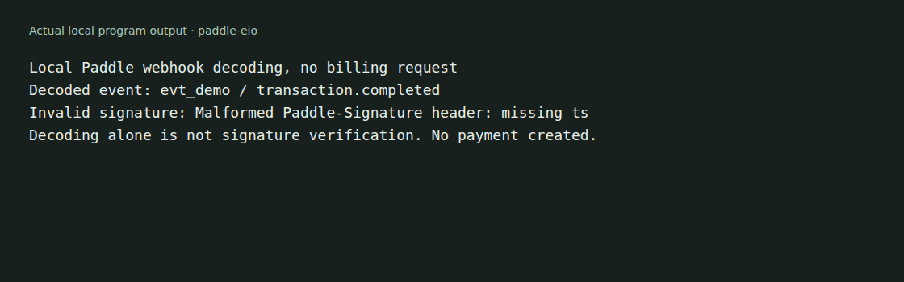

# paddle-eio

An OCaml Eio client for selected Paddle Billing operations: catalog prices,
transactions, customer-portal sessions and webhook verification. It returns
small typed projections rather than exposing the whole provider API.



The example uses a synthetic webhook body. It sends no billing request and
creates no payment. See [capture details](docs/demo/README.md).

## Build and try the example

Use an OCaml 5.2 or later switch and Dune 3.12 or later:

```sh
git clone https://github.com/Microapps-Labs/paddle-eio.git
cd paddle-eio
opam install . --deps-only --with-test
./scripts/secret-safe-exec.sh opam exec -- dune exec examples/demo/main.exe
./scripts/secret-safe-exec.sh opam exec -- dune runtest
```

The example decodes local JSON and rejects a malformed signature. Decoding an
event does not authenticate it. Use the unmodified raw body and the destination's
secret for signature verification, as described in
[Paddle's verification guide](https://developer.paddle.com/webhooks/about/signature-verification/).

## Use in an application

Create and reuse a client with `Paddle_eio.create ~net ~clock ~environment ~api_key ()`.
Choose `Sandbox` or `Live` explicitly. The executable must initialize the
cryptographic RNG before making TLS connections. `disabled ()` returns a client
whose operations report missing configuration.

The [public interface](lib/paddle_eio.mli) documents price lookup, transaction
creation, complete item-list replacement, cancellation and portal sessions.
This client sends each mutation once and does not automatically retry it. A
transport error after a mutation does not establish whether the provider applied
it. Your application owns reconciliation and any entitlement changes.

Transaction updates replace the full item list. Cancellation eligibility is a
provider rule, not a guarantee made by the client. Consult
[Paddle's current transaction API](https://developer.paddle.com/api-reference/transactions/update-transaction/)
for allowed states. These source references were checked on 2026-10-23.

## Scope and testing

The local example and fixtures do not establish a live or sandbox account flow.
The package handles only the operations in its interface and is not a complete
Paddle SDK. See [SECURITY.md](SECURITY.md) for the repository's credential and
reporting practices.

The package metadata declares MIT. No standalone license file is included.
